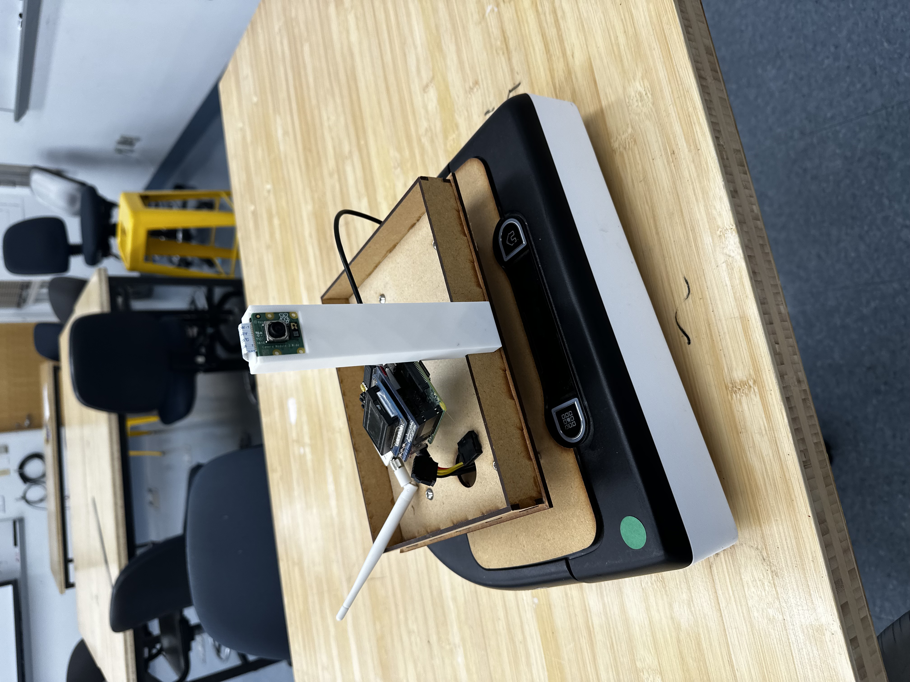
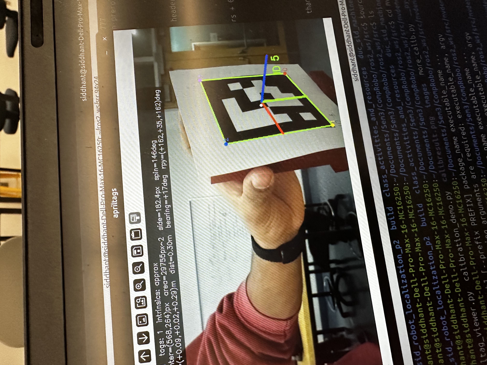
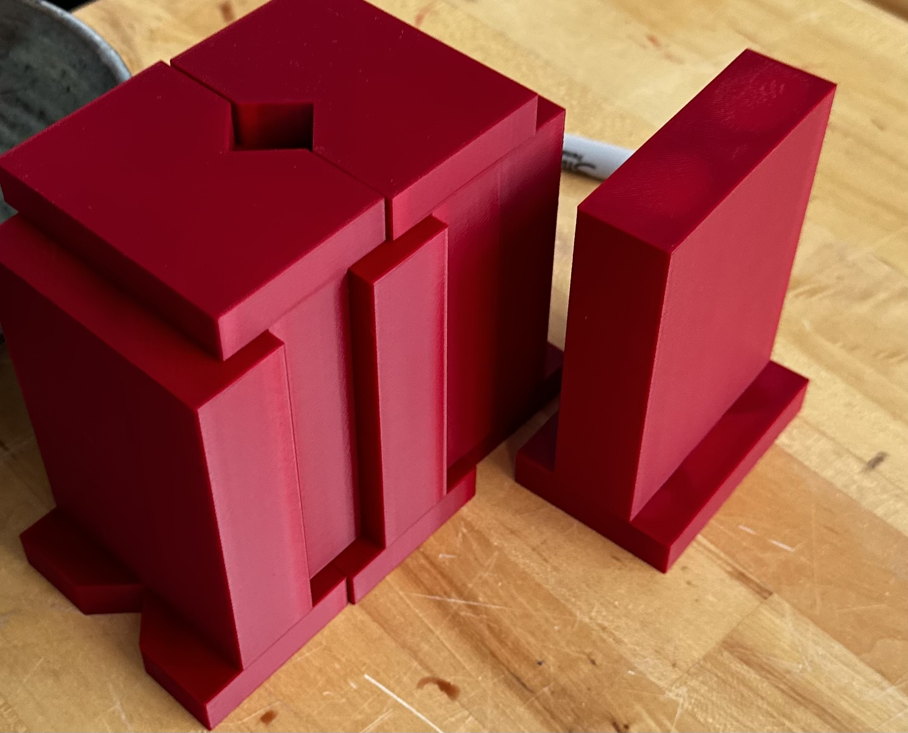
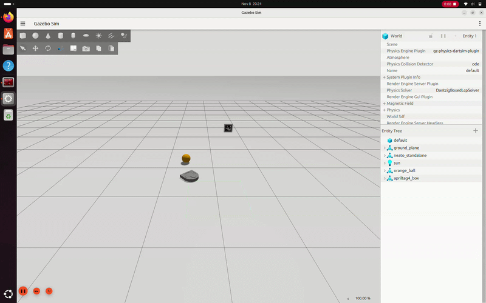

# Intro to Computational Robotics project 3: Machine Vision

*Figure 1. Neato robot with custom extended camera mount module to see apriltags above ball when dribbling*
## Project Goal
We were inspired by the online video game Rocket League. In this game, players face off in 1v1, 2v2, or 3v3 games of soccer, except the players themselves are cars. In the game there are boosts on certain locations in the ground where your speed is temporarily increased. Additionally, you are able to jump and make your car fly to perform aerial kicks and maneuvers, but we did not choose to implement this for our project (since our robot cannot fly or jump). 

We wanted to implement three main functions in our project: 
1. Enabling the robot to understand its position in a set "field" 
2. having a robot kick a real ball into a "goal area"
3. when the robot understands that it is in a certain area, increase its max speed for a short time (boost)

The catch: EVERYTHING must be implemented with a single camera sensor mounted on the front of the robot. No lidar or odometry.

In our setup, Duc primarily worked on the ball striking mechanics while Siddhant worked on localizing the robot in the field through apriltags.

## How did we solve this problem?
Our project can essentially be broken down into two sections: Using apriltags placed around the field to determine an x, y, $\theta$ pose in our map frame, and identifying a "goal" area and kicking the ball into it. 

The very first step: Is this possible? Answer: **Yes***. Using a basic april tag script we got from online, we were able to show that our camera setup was able to reliably determine a 3d angle of a line normal to the apriltag surface. Later to localize ourselves in the field, we calibrated our camera using a guide from OpenCV to generate a calibration numpy array, which we passed into another function to find the line normal to the surface and estimate the pose. This brought us a translation and rotation vector relative to our camera, which we used known parameters to project onto 2d floor space. Apriltags are placed in all four corners of the square map, as well as on edges of opposing sides, so they all face the middle, and the tags themselves have an ID number encoded on them, which we also have known positions for. Through set distance parameters, we can infer whether the robot is a certain distance from center and send messages to boost topic when applicable. 


*Figure 2 apriltag library demo script showing camera accuracy for calculating apriltag heading*


Next is the ball kicking. Based on our localization node, we already have an estimate for the position of the robot. We already know where the goal is because of its fixed position in the field. Now we need to know where the ball is and where to hit the ball. To do this, we chose a bright orange basketball. Because of the stark contrast between our testing environment and the ball, we are able to take advantage of the HSV coordinate representation of our image to easily distinguish pixel values between the ball and everything else. Once we have masked out the orange pixels, we take the largest blob and fit a circle to it. The distance from the ball is calculated by how big this circle is, which is a calibration constant divided by radius. The direction is how far it sits from the center of the camera. Combining this relative position from the camera and the robot location in the map, we know the ball's position in the field. 

Our final step is a simple finite state machine that is run. It spins in place until it finds a ball, drives to a point a set .35m behind the ball in line with the goal, and then drives through the ball into the goal. 


## One design decision we made
We made the intentional choice to omit lidar/odometry readings from our implementation, as well as stereo camera. Our goal for this was to get comfortable implementing monocular machine vision in our robot, even if it cost us accuracy (it cost us a lot of accuracy). Even several degree miscalculations of apriltag heading and slight lens distortions could lead to massive inaccuracies in localization, which compounds into errors in hitting the ball. This is definitely not the approach we would take in an actual robotic system outside of a learning environment. Instead, we would use machine vision to supplement other sensors especially to low-tolerance functions like localization.


## What if any challenges did you face along the way?
By far the biggest challenge we faced was debugging hardware issues. This led us to massively reduce the scope of our project and not implement all of the functionality we wanted. Even in simulation however, the inaccuracies of MV can be seen, in the absence of camera noise, lens distortion, friction, and other issues. 

## Future improvements

The biggest improvement we could make at this point is actually debugging the hardware issue and making the behaviors work in real life. We added things like exponential smoothing and tolerances in the ball pursuit node, but until our issues with publishing to cmd_vel got solved there was nothing we could do. Past that, using the lidar and odometry in some way is an obvious extension to make our localization orders of magnitude more accurate. We would also add dribbling functionality and simple game mechanics so multiple neatos could play each other or against a teleop player. Plus, while calculations for the boost timings and made, the actual publishing of the higher velocity value has not been implemented.

## Lessons for future robotics projects
One massive lesson we learned from this project is to debug hardware issues early, since real life factors and the black box of neato libraries have a lot of complexity that we sometimes cannot account for. Aside from that, we learned that using preexisting open source libraries can speed up the process of development a lot, even for simple things like numpy. To maximize time spent on topics that matter most and getting used to implementing and adapting tools and other people's code in our own work, we can extend the scope of our work and focus attention on actual learning goals and customizing behaviors to our needs. 

## Real life applications of our system
Using machine vision as a means to localize a robot in a controlled environment is an extremely powerful tool. Specifically using apriltags to localize is advantageous in environments where budget is constrained, since cameras can be very cheap and simple computation on apriltags does not take a significant amount of processing power. Outside of using apriltags, with more advanced methods like transformer models and large feature recognizing datasets, we believe the majority of robots in the future will primarily use machine vision to localize themselves, especially with large datasets like google maps. 


*Figure 3: 1% infill tag holders to keep apriltags at a consistent height, with 90° slit for angle alignment*


*Figure 4. ball kicking behavior demonstration*

## How to run
Build the package (from the root of your ROS 2 workspace):
```bash
colcon build --symlink-install --packages-select machine_vision_pkg
source install/setup.bash
```

Connect to the Neato (this also starts the camera stream):
```bash
ros2 launch neato_node2 bringup.py host:=<neato_ip>
```

Start AprilTag localization (publishes `/pose` and `/boost`):
```bash
ros2 run machine_vision_pkg localization_node
```

Start ball pursuit (finds the ball and pushes it into the goal):
```bash
ros2 run machine_vision_pkg ball_pursuit_node
```

Optional: view live AprilTag detections:
```bash
ros2 run machine_vision_pkg apriltag_viewer
```

AI disclosure:
Code double checked and finalized by AI, all root code conceptualized and written by us. Also helped with debugging hardware.
Example prompt: The robot is not connecting. What could be a possible issue?
Youtube video link:
https://youtu.be/naVfPzm42fk
